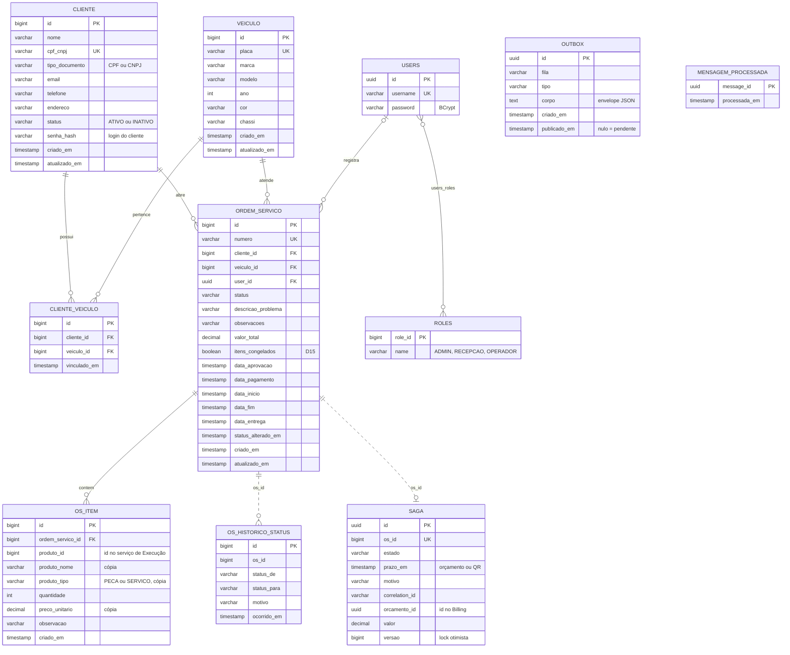

# Oficina — OS Service

Microsserviço de ordens de serviço da Fase 4 do Tech Challenge: abertura, status, histórico, cliente, veículo, usuário e **orquestração da Saga**.

| Serviço | Responsabilidade | Banco |
|---|---|---|
| **OS** (este repositório) | OS, cliente, veículo, usuário, orquestrador | PostgreSQL |
| [Execução](https://github.com/KauaAlmeidaSilveira/fiap-15soat-oficina-execucao) | Fila, diagnóstico, reparo, produto, estoque | PostgreSQL |
| [Billing](https://github.com/KauaAlmeidaSilveira/fiap-15soat-oficina-billing) | Orçamento, aprovação, pagamento, Mercado Pago | DynamoDB |

## Saga orquestrada

O fluxo tem compensações que dependem da ordem do que já aconteceu: depois do pagamento, por exemplo, é preciso reembolsar antes de devolver o estoque. Por isso a escolha foi **orquestração**, com o orquestrador dentro deste serviço:

- **O fluxo fica em um lugar só:** `OrquestradorSagaUseCase` mostra todas as transições. Em coreografia, a mesma regra ficaria espalhada entre os consumidores dos três serviços.
- **Compensar exige saber o estado:** o orquestrador sabe o que já foi feito e o que falta desfazer.
- **Prazos têm dono:** os 7 dias do orçamento e a validade do QR são vigiados a partir do estado persistido.
- **Custo aceito:** o OS Service conhece os comandos dos outros serviços e fica no caminho de todo o fluxo. Mensagens aguardam na fila enquanto ele reinicia.

O orquestrador fica no OS Service porque a OS é a dona do processo, e um quarto serviço não traria benefício para este volume.

```
abrir OS → diagnóstico → orçamento → aprovação → baixa de estoque → cobrança → pagamento → reparo → finalização
```

| Falha | O que desfaz | Status final da OS |
|---|---|---|
| Orçamento recusado | Nada: a baixa só ocorre na aprovação | `REPROVADA` |
| Falha ao gerar orçamento | Descongela os itens | `EM_DIAGNOSTICO` |
| Cliente sem resposta em 7 dias | Expira o orçamento | `CANCELADA` |
| Estoque insuficiente | Cancela o orçamento | `CANCELADA` |
| Falha ao gerar cobrança | Encerra a cobrança, devolve o estoque, cancela o orçamento | `CANCELADA` |
| Pagamento recusado ou QR expirado | Devolve o estoque, cancela o orçamento | `CANCELADA` |
| Falha ao enviar para execução | Reembolsa, devolve o estoque, cancela o orçamento | `CANCELADA` |
| Pagamento depois do cancelamento | Reembolsa | `CANCELADA` |
| Cancelamento com reparo em andamento | Cancela o reparo, reembolsa, devolve as peças, cancela o orçamento | `CANCELADA` |
| Reembolso falhou | Nada automático: alerta e `POST /{id}/saga/reprocessar` | Sem mudança |

Catálogo completo, estados e casos de corrida: [plano das Seções 0 a 4](docs/plano-secoes-0-4.md).

### Garantias

- **Estado persistido:** tabela `saga` no PostgreSQL. A Saga continua depois de reiniciar o serviço, e há cenário BDD que prova isso.
- **Publicação confiável:** outbox na mesma transação da mudança de estado.
- **Consumo idempotente:** inbox por `messageId`, mais guarda de estado para evento fora de ordem.
- **Falhas:** cinco tentativas e depois DLQ.

## Comunicação

REST só quando quem chama precisa da resposta para responder ao próprio chamador: OS → Execução para copiar os dados do produto, Lambda → OS para autenticar, Billing → Mercado Pago. O fluxo da Saga é todo por SQS. Nenhum serviço acessa o banco de outro.

## Bancos

PostgreSQL em OS e Execução: as relações entre OS, itens, clientes e veículos, e o saldo de estoque travado em transação, pedem SQL. DynamoDB no Billing: orçamento e cobrança são documentos lidos por OS, sem junções, e a escrita condicional dá a idempotência da decisão e do pagamento.

## Modelo de dados

PostgreSQL (`oficina_os`), tabelas criadas pelo Hibernate a partir das entidades JPA. Linhas cheias são chaves
estrangeiras; as tracejadas, referências por id sem FK.



- **Cópia do produto em `os_item`:** nome, tipo e preço são copiados da Execução (`GET /internal/produtos/{id}`) ao
  adicionar o item; não há FK para outro banco.
- **`saga`:** uma por OS, com o estado do orquestrador e o prazo vigiado pelo agendador. `versao` evita que duas
  réplicas avancem a mesma Saga.
- **`outbox` e `mensagem_processada`:** publicação na mesma transação da mudança de estado e consumo idempotente por
  `messageId`.

## Rodar

Requer Java 21, Maven 3.9+, Docker e os repositórios de Execução e Billing na pasta vizinha.

```bash
sh scripts/gerar-chaves-locais.sh
docker compose up -d --build --wait   # OS 8081, Execução 8082, Billing 8083, Mailpit 8025, WireMock 8089
sh scripts/rodar-bdd.sh               # sobe tudo, roda os cenários Cucumber e derruba
```

Para usar a API real do Mercado Pago (credenciais de teste) no lugar do WireMock, preencha o `.env` a partir
do `.env.example` e suba com o arquivo extra. O BDD continua no WireMock.

```bash
docker compose -f docker-compose.yml -f docker-compose.mercadopago.yml up -d --build --wait
```

Para os testes unitários e de integração, com Docker ligado para o Testcontainers:

```bash
openssl genpkey -algorithm RSA -pkeyopt rsa_keygen_bits:2048 -out src/main/resources/jwt.private.key
openssl rsa -in src/main/resources/jwt.private.key -pubout -out src/main/resources/jwt.public.key
cp src/main/resources/jwt.private.key src/main/resources/servico.private.key
cp src/main/resources/jwt.public.key src/main/resources/servico.public.key
mvn verify
```

## Qualidade (SonarQube)

O enunciado pede validação de qualidade "via SonarQube ou similar no CI". O passo está no
`.github/workflows/ci.yml` de cada serviço (SonarCloud, ligado pelo secret `SONAR_TOKEN`), mas o GitHub
Actions das contas está bloqueado por billing. A validação roda localmente, com o mesmo quality gate:

```bash
sh scripts/sonar-local.sh          # sobe o SonarQube em Docker, roda mvn verify e a análise dos 3 serviços
                                    # e espera o quality gate "Sonar way"; painel em http://localhost:9000
```

O script sai com erro se algum serviço falhar nos testes ou no gate. Resultado de 15/11/2026:

| Serviço | Quality gate | Cobertura | Confiabilidade | Segurança | Revisão de segurança | Manutenibilidade | Duplicação |
|---|---|---|---|---|---|---|---|
| OS | Passou | 95,4% | A (0 bugs) | A (0 vulnerabilidades) | A (100% revisado) | A | 0% |
| Execução | Passou | 94,4% | A (0 bugs) | A (0 vulnerabilidades) | A (100% revisado) | A | 0% |
| Billing | Passou | 92,5% | A (0 bugs) | A (0 vulnerabilidades) | A (100% revisado) | A | 0% |

Revisões registradas no SonarQube: CSRF desligado é seguro (APIs stateless, autenticação só por
`Authorization: Bearer`, sem cookie nem sessão); CORS liberado é seguro (`allowCredentials=false`, token
Bearer, entrada pelo API Gateway); a regra S5841 em `ExecucaoControllerTransacaoIT` é falso positivo (o teste
afirma que um evento não foi publicado, e a lista vazia é o caso esperado).

## Documentos

- [Arquitetura: diagrama geral, divisão dos serviços e tecnologias](docs/arquitetura.md)
- [Checklist de entrega](CHECKLIST.md)
- [Plano das Seções 0 a 4](docs/plano-secoes-0-4.md)
- [Requisitos da Fase 4](docs/requisitos-fase4.md)
- [Destino dos endpoints e entidades](docs/mapa-endpoints-entidades.md)
