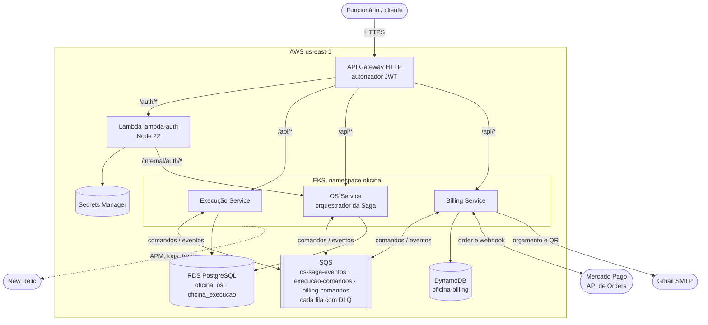

# Arquitetura — Fase 4

Visão geral do sistema da oficina depois da divisão do monólito da Fase 3 em microsserviços: componentes,
bancos, comunicação e por que cada escolha foi feita. A estratégia de Saga está no [README](../README.md#saga-orquestrada)
e o catálogo de comandos e eventos em [plano-secoes-0-4.md](plano-secoes-0-4.md#4-catálogo-de-eventos).

## Diagrama geral

Setas cheias são chamadas e mensagens; a tracejada, telemetria do agente New Relic nos 3 serviços.

- **Entrada:** do Gateway aos serviços o caminho é VPC Link e um NLB interno por serviço. O webhook do Mercado
  Pago também entra pelo Gateway (`POST /webhooks/mercado-pago`, rota pública) e chega ao Billing.
- **Filas:** o OS envia comandos para `oficina-execucao-comandos` e `oficina-billing-comandos`; Execução e
  Billing respondem com eventos em `oficina-os-saga-eventos`.
- **REST síncrono**, só em três pontos: Lambda → OS (`/internal/auth/*`), OS → Execução (`/internal/produtos`)
  e Billing → Mercado Pago.
- **Rede:** EKS, RDS e Lambda ficam em subnets privadas.

## Componentes

| Componente | Repositório | Papel |
|---|---|---|
| API Gateway (HTTP API) | `lambda-auth` | Porta de entrada única. Valida o JWT de sessão (`iss` = endpoint do Gateway, `aud` = `oficina-api`) e roteia por prefixo para o NLB de cada serviço pelo VPC Link. Rotas públicas só para login, link de aprovação, webhook do Mercado Pago, health e Swagger |
| Lambda `lambda-auth` | `lambda-auth` | Login de funcionário e de cliente e emissão do token de sessão. Não acessa banco: consulta o OS em `/internal/auth/*` com um token de serviço |
| OS Service | `os` | Ordem de serviço, cliente, veículo, usuário e o orquestrador da Saga |
| Execução Service | `execucao` | Fila de execução, diagnóstico, reparo, produto e estoque |
| Billing Service | `billing` | Orçamento, aprovação pelo link, cobrança e pagamento no Mercado Pago, e-mails |
| SQS | `infra-k8s` | Uma fila de entrada por consumidor, cada uma com DLQ depois de 5 recebimentos |
| EKS | `infra-k8s` | Cluster com os 3 serviços, `HPA` por serviço e credenciais AWS por EKS Pod Identity (uma role por serviço) |
| RDS PostgreSQL | `infra-db` | Uma instância com dois databases, `oficina_os` e `oficina_execucao`, cada um com usuário dono só do próprio |
| DynamoDB | `infra-db` | Tabela única `oficina-billing` |
| New Relic | `os/observability` | APM e trace distribuído dos 3 serviços, logs com contexto, dashboard e alertas em Terraform |

`/internal/**` não tem rota no Gateway: só é alcançável de dentro da VPC.

## Divisão dos microsserviços

O enunciado pede ao menos três serviços: ordem de serviço, pagamento e execução. A divisão seguiu quem é
**dono de cada dado e de cada decisão**, para que nenhum serviço precise do banco de outro (D4):

| Serviço | Dono de | Por que fica aqui |
|---|---|---|
| OS | `OrdemServico`, itens, histórico, `Cliente`, `Veiculo`, `User`, estado da Saga | A OS é o processo de negócio, e quem é dono do processo coordena as etapas. Cliente, veículo e usuário são lidos em toda abertura de OS e no login; separados, cada abertura viraria chamada síncrona |
| Execução | `Produto`, saldo e movimentação de estoque, fila de execução | Quem diagnostica e repara é quem consome peças. A baixa de estoque precisa travar o saldo na mesma transação da movimentação, então produto e estoque ficam juntos |
| Billing | Orçamento, aprovação, cobrança e pagamento | Concentra a integração externa (Mercado Pago), o e-mail ao cliente e o token próprio do link de aprovação. Uma falha do Mercado Pago fica isolada aqui |

Alternativas descartadas:

- **Serviço próprio de cliente e veículo:** o volume não justifica, e a abertura de OS passaria a depender dele de forma síncrona.
- **Quarto serviço só para orquestrar a Saga:** a OS já é dona do processo; outro serviço só acrescentaria deploy e saltos de rede.
- **Estoque no Billing**, junto do orçamento: a baixa e a devolução acontecem por causa do reparo, e o Billing passaria a precisar de banco relacional.

O custo aceito é que o OS conhece os comandos dos outros dois e está no caminho de todo o fluxo. Enquanto ele
reinicia, as mensagens esperam na fila, e o estado da Saga persistido continua de onde parou.

## Tecnologias

| Escolha | Alternativas | Por quê |
|---|---|---|
| Java 21 e Spring Boot 3.2 nos serviços | — | Mesma base do monólito: o domínio, as regras e os testes da Fase 3 foram reaproveitados, com o mesmo layout em `core`, `dataprovider` e `entrypoint` |
| PostgreSQL no OS e na Execução | — | Relações entre OS, itens, cliente e veículo, e saldo de estoque travado em transação pedem SQL |
| DynamoDB no Billing | MongoDB (plano B da D6) | Orçamento e cobrança são documentos lidos pela OS, sem junções. A escrita condicional dá a idempotência da decisão do orçamento e do pagamento. Gerenciado e sem servidor para operar |
| Uma instância RDS com dois databases | Uma instância por serviço | Isolamento por database e usuário, sem pagar duas instâncias; nenhum serviço tem credencial do banco do outro |
| SQS Standard | SNS, FIFO, Kafka/MSK | Na orquestração cada mensagem tem um destino só, então não há fan-out. Inbox e guarda de estado já tratam duplicata e ordem, o que tira a vantagem da FIFO. DLQ nativa e nada para operar |
| Saga orquestrada, com outbox e inbox | Coreografia | As compensações dependem da ordem do que já aconteceu (reembolsar antes de devolver estoque); detalhes no [README](../README.md#saga-orquestrada) |
| REST síncrono em três pontos | Tudo por mensagem | Só onde quem chama precisa da resposta para responder ao próprio chamador: OS → Execução (dados do produto), Lambda → OS (login) e Billing → Mercado Pago |
| JWT RS256 com três pares de chave | Uma chave só | Sessão (emitida pela Lambda), serviço (chamadas internas, 60 s) e aprovação (link do orçamento, só no Billing). Nenhum serviço Java guarda a chave privada de sessão |
| API Gateway HTTP + Lambda | Ingress no cluster | Já validados na Fase 3; o autorizador JWT barra token inválido antes de chegar ao cluster |
| EKS com HPA | ECS | Mantém os manifestos e o HPA da Fase 3; um cluster com deploy e banco por serviço (D7) |
| EKS Pod Identity | Chaves de acesso em `Secret` | Cada pod recebe só as permissões da própria role: filas próprias e, no Billing, a tabela |
| Mercado Pago, API de Orders com QR dinâmico | Checkout Pro | O cliente paga pelo QR que recebe por e-mail. O webhook nunca confirma pelo corpo: o Billing consulta `GET /v1/orders/{id}` |
| New Relic | CloudWatch, X-Ray | Exigência do enunciado (ferramenta da Fase 3). O trace atravessa a fila pelo campo `rastreio` do envelope |
| Terraform | CloudFormation, CDK | Já usado na Fase 3 para VPC, EKS, RDS, Lambda e Gateway |

## Restrições de ambiente

- **Conta AWS pessoal com cota de 1 vCPU.** O cluster roda com um node `r6g.medium` (ARM), requests de CPU de 50m e
  `HPA` de 1 a 2 réplicas. O padrão do Terraform é 2 × `t4g.medium`.
- **Sem GitHub Actions** (bloqueado por billing): build, testes, Sonar e deploy rodam pelos scripts do OS.
- **Ambiente efêmero:** sobe para testar ou gravar e é destruído em seguida (`SUBIR-AMBIENTE.md`, fora do git).
