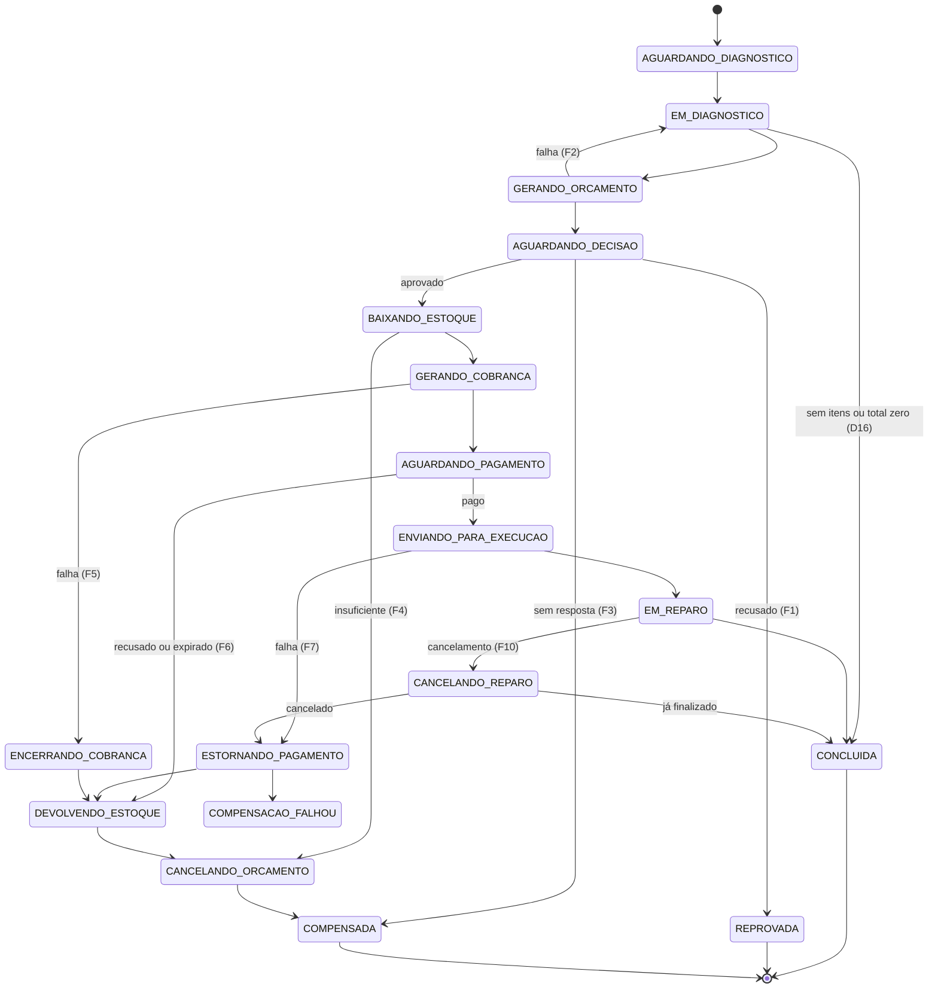

# Plano — Tech Challenge Fase 4, Seções 0 a 4 e higiene

> Estado: **aprovado em 02/11/2026; passos 1 a 6 implementados e testados localmente em 03/11/2026**. Falta validar com AWS, Mercado Pago e SonarCloud reais (seção 1).
> Base: `CHECKLIST.md`, PDF do enunciado, código de `fiap-15soat-oficina-api` e `lambda-auth`, documentação do Mercado Pago lida em 02/11/2026.
> Marcação: **[Dn]** decisão do checklist · **[técnico]** escolha de implementação.

## 1. Pendências externas

Não impedem o desenvolvimento: até lá, LocalStack substitui SQS e DynamoDB, e WireMock substitui o Mercado Pago. O que depende delas fica aberto no checklist: D5, D6 e os testes reais de pagamento.

| # | Bloqueio | Situação | Quem resolve |
|---|---|---|---|
| B1 | SQS e DynamoDB na conta AWS (D5, D6) | **Pendente:** ainda sem conta definida (outra conta Academy ou conta do Júlio) | Kauã e Júlio |
| B2 | Conta de teste do Mercado Pago | **Pendente:** depende de conta, loja, caixa (`external_pos_id` é obrigatório) e do app no celular com a conta compradora | Kauã |

D7 (cluster compartilhado) não bloqueia estas seções, porque o desenho funciona nos dois modelos.

**Plano B do broker:** o checklist só prevê plano B para o banco (MongoDB). Se o SQS falhar em B1, proponho RabbitMQ no cluster, que o PDF aceita, atrás da mesma porta de publicação e consumo.

### Correções ao checklist encontradas nesta leitura

- O link do QR dinâmico da Seção 0 devolve **404**. A página atual é `/developers/pt/docs/qr-code/payment-processing`.
- A API atual é `POST /v1/orders`, com `type: qr`, `config.qr.mode: dynamic`, `external_reference` e `X-Idempotency-Key`. Os status documentados são `created`, `processed`, `expired`, `refunded` e `canceled`.
- **A documentação não traz status de recusa na order.** Um cartão recusado pode não encerrar a order. O passo 0 testa isso com o cartão Elo Débito de teste.
- **A documentação é contraditória sobre a assinatura:** a página geral de webhooks diz que notificações de QR não podem ser verificadas com a assinatura secreta, e a de notificações de order mostra `x-signature`. Por isso a confirmação **nunca** depende só do webhook: toda notificação gera `GET /v1/orders/{id}`, e um webhook forjado não confirma pagamento.
- Hoje a aprovação **não confere saldo**: `registrarSaidasEstoque` chama o gateway direto e o saldo pode ficar negativo. Só a saída manual verifica. "Estoque insuficiente" é regra nova, não migração.
- O repositório `api` está sem alterações locais. O item de higiene "alteração não commitada em `CHECKLIST.md`" não se confirma e pode ser fechado.

## 2. Decisões de negócio desta rodada

Respondidas pelo Kauã em 02/11/2026 e registradas na Seção 0 do checklist.

| # | Caso | Decisão |
|---|---|---|
| D13 | Entrega do QR | E-mail com imagem do QR e código copia-e-cola, reutilizando o template atual |
| D14 | Validade do QR | 24 h, configurável (vídeo com 2 min) |
| D15 | Itens depois do diagnóstico | Congelam ao concluir o diagnóstico |
| D16 | OS sem itens ou com total zero | Conclui o diagnóstico e encerra sem orçamento, cobrança ou reparo, em `FINALIZADA`; pode ir a `ENTREGUE` |
| D17 | Falha ao gerar orçamento | Volta a `EM_DIAGNOSTICO`, com alerta; a oficina conclui de novo |
| D18 | Estoque insuficiente ou falha de cobrança depois da aprovação | `CANCELADA`, devolvendo o que foi baixado, sem nova tentativa |
| D19 | Falha ao enviar para execução, ou pagamento depois do cancelamento | Reembolso automático, devolução de estoque e `CANCELADA` |
| D20 | E-mails | Orçamento *best-effort* (a oficina ainda aprova por `PATCH /aprovar`). QR com 3 tentativas, depois falha de cobrança. Cliente avisado se a OS for cancelada depois de aprovada |
| D21 | `PATCH /avancar-status` | Só `FINALIZADA → ENTREGUE`; os outros casos respondem 422, e o operador usa as rotas de Execução |
| D22 | Cancelamento com reparo em andamento | `ADMIN` e `OPERADOR`, motivo obrigatório, antes de `FINALIZADA`. Reembolso integral, todas as peças voltam ao estoque (a oficina retira o que já instalou), OS `CANCELADA` |
| D23 | Efeitos aceitos | `PATCH /aprovar` responde **202** (segunda tentativa continua em 409). OS entra em `EM_EXECUCAO` ao enfileirar o reparo, `dataInicio` é o início real, e `tempo-medio` não conta a fila. Histórico só para funcionários |

**Fora do pedido, só para registro:** `GET /aprovacao-os` executa a decisão no próprio GET. Antivírus de e-mail que abrem links podem aprovar sozinhos, e agora isso dispararia baixa e cobrança. O risco já existe na Fase 3. Não incluí correção.

## 3. Divisão dos serviços

### Entidades e endpoints

| Serviço | Banco | 10 entidades JPA atuais | 37 endpoints atuais |
|---|---|---|---|
| OS | PostgreSQL | `OrdemServico`, `OsItem`, `Cliente`, `Veiculo`, `ClienteVeiculo`, `User`, `Role` | 27: `ordens-servico` (9), `minhas-ordens-servico` (2), `clientes` (7), `veiculos` (8), `auth/register` (1) |
| Execução | PostgreSQL | `Produto`, `SaldoEstoque`, `MovimentacaoEstoque` | 9: `produtos`, incluindo estoque |
| Billing | DynamoDB | nenhuma | 1: `/aprovacao-os` |

A tabela endpoint por endpoint fica em `docs/` no repositório do OS como item do passo 1.

**Novos:**

- OS: `GET /api/ordens-servico/{id}/historico`, `POST /api/ordens-servico/{id}/cancelar` (202, corpo com `motivo`) [D22], tabela `os_historico_status`, `saga`, `saga_transicao`, `outbox`, `mensagem_processada`, e `/internal/auth/*`.
- Execução: `GET /api/execucoes`, `POST /api/execucoes/{osId}/diagnostico/iniciar` e `/concluir`, `POST /api/execucoes/{osId}/reparo/iniciar` e `/finalizar`, `GET /internal/produtos/{id}`; tabela `fila_execucao`, `outbox`, `mensagem_processada`.
- Billing: `POST /webhooks/mercado-pago`, `GET /api/orcamentos/{osId}`, `GET /api/pagamentos/{osId}`; tabela única DynamoDB com orçamento, cobrança, webhook recebido, outbox e inbox.

**FKs que caem:** `os_item.produto_id` vira valor simples com cópia de nome, tipo e preço (o domínio já tem esses campos). `movimentacao_estoque.ordem_servico_id` vira valor simples. As FKs para cliente, veículo e usuário ficam, pois os donos continuam no OS (D4).

**Máquina de estados da OS:** `RECEBIDA → EM_DIAGNOSTICO → AGUARDANDO_APROVACAO → AGUARDANDO_PAGAMENTO → EM_EXECUCAO → FINALIZADA → ENTREGUE`, mais o atalho `EM_DIAGNOSTICO → FINALIZADA` [D16] e os terminais `REPROVADA` e `CANCELADA`. `CANCELADA` e `AGUARDANDO_PAGAMENTO` entram na listagem padrão: a primeira oculta, a segunda em `PRIORIDADE_LISTAGEM`. Sem essa entrada, o comparador atual falharia com `NullPointerException`.

### Comunicação síncrona

Regra **[técnico]**: REST só quando quem chama precisa da resposta para responder ao próprio chamador. Todo o fluxo da Saga é mensagem.

| Origem → destino | Uso | Se o destino falhar |
|---|---|---|
| OS → Execução `GET /internal/produtos/{id}` | Copiar nome, tipo e preço ao adicionar item | 503; abrir OS sem itens continua funcionando |
| `lambda-auth` → OS `/internal/auth/*` | Substitui as 3 consultas de `repositorio.js`, com a mesma assinatura | Login indisponível (503) |
| Billing → Mercado Pago | Criar, consultar, cancelar e reembolsar order | Volta à fila e tenta de novo; `X-Idempotency-Key` derivada do ID da cobrança |

Timeouts de 1 s para conexão e 2 s para leitura nas chamadas internas. Billing não chama o OS: o comando leva os dados do cliente, do veículo e os itens.

### Autenticação entre serviços [técnico]

- JWT de 60 s, com `aud` igual ao destino e `iss` igual à origem.
- Quem assina: `lambda-auth` com a chave que já tem; OS com par próprio para falar com Execução.
- `/internal/**` não tem rota no API Gateway.
- Billing ganha **par de chaves próprio para o link de aprovação**. Assim, nenhum serviço Java guarda a chave privada de sessão, o que reforça a exclusão mútua dos tokens. As checagens atuais de `sub`, `iss` e ausência de `aud` são mantidas.

## 4. Catálogo de eventos

**Broker [técnico]:** SQS Standard, sem SNS, porque na orquestração cada mensagem tem um único destino. Não usei FIFO porque deduplicação e ordem seriam parciais de qualquer forma; inbox e guarda de estado resolvem qualquer caso de entrega.

| Fila | Consumidor | DLQ |
|---|---|---|
| `oficina-os-saga-eventos` | OS (orquestrador) | `-dlq` |
| `oficina-billing-comandos` | Billing | `-dlq` |
| `oficina-execucao-comandos` | Execução | `-dlq` |

`maxReceiveCount` = 5, com retenção de 14 dias nas DLQs.

**Envelope:**

```json
{
  "messageId": "uuid",
  "tipo": "BaixarEstoque",
  "versao": 1,
  "sagaId": "uuid",
  "osId": 123,
  "correlationId": "uuid",
  "causationId": "uuid da mensagem que causou esta",
  "ocorridoEm": "2026-11-02T12:00:00Z",
  "payload": {}
}
```

### Comandos (sempre OS → serviço)

| # | Comando | Destino | Payload | Respostas possíveis |
|---|---|---|---|---|
| C1 | `EnfileirarDiagnostico` | Execução | `numero`, `descricaoProblema`, `veiculo` | `DiagnosticoEnfileirado` |
| C2 | `GerarOrcamento` | Billing | `numero`, `itens[]`, `valorTotal`, `cliente{nome,email}`, `veiculo{marca,modelo,placa}` | `OrcamentoGerado`, `OrcamentoFalhou` |
| C3 | `RegistrarDecisaoOrcamento` | Billing | `aprovado`, `origem=OFICINA`, `usuario` | `OrcamentoAprovado`, `OrcamentoRecusado` |
| C4 | `ExpirarOrcamento` | Billing | `orcamentoId` | `OrcamentoExpirado`, ou a decisão que chegou antes |
| C5 | `BaixarEstoque` | Execução | `itens[]{produtoId,quantidade}`, só `PECA` | `EstoqueBaixado`, `EstoqueInsuficiente` |
| C6 | `GerarCobranca` | Billing | `orcamentoId`, `valor`, `cliente` | `CobrancaGerada`, `CobrancaFalhou` |
| C7 | `EnfileirarReparo` | Execução | `numero`, `itens[]` | `ReparoEnfileirado`, `ReparoRecusado` |
| C8 | `EncerrarCobranca` | Billing | `orcamentoId`, `motivo` | `PagamentoFalhou`, ou `PagamentoConfirmado` se já pago |
| C9 | `EstornarPagamento` | Billing | `mpOrderId`, `motivo` | `PagamentoEstornado`, `EstornoFalhou` |
| C10 | `DevolverEstoque` | Execução | `motivo` | `EstoqueDevolvido` |
| C11 | `CancelarOrcamento` | Billing | `orcamentoId`, `motivo`, `avisarCliente` [D20] | `OrcamentoCancelado` |
| C12 | `CancelarReparo` | Execução | `motivo`, `usuario` | `ReparoCancelado`, `ReparoJaFinalizado` |

### Eventos (serviço → `oficina-os-saga-eventos`)

| Produtor | Evento | Payload além do envelope | Origem |
|---|---|---|---|
| Execução | `DiagnosticoEnfileirado` | — | C1 |
| Execução | `DiagnosticoIniciado` | `iniciadoEm` | Operador |
| Execução | `DiagnosticoConcluido` | `concluidoEm` | Operador |
| Billing | `OrcamentoGerado` | `orcamentoId`, `valorTotal`, `expiraEm`, `emailEnviado` | C2 |
| Billing | `OrcamentoFalhou` | `motivo` | C2 |
| Billing | `OrcamentoAprovado` | `orcamentoId`, `origem`, `decididoEm` | Link ou C3 |
| Billing | `OrcamentoRecusado` | `orcamentoId`, `origem`, `decididoEm` | Link ou C3 |
| Billing | `OrcamentoExpirado` | `orcamentoId` | C4 |
| Billing | `OrcamentoCancelado` | `orcamentoId` | C11 |
| Execução | `EstoqueBaixado` | `movimentacoes[]` | C5 |
| Execução | `EstoqueInsuficiente` | `faltantes[]{produtoId,saldo,solicitado}` | C5 |
| Execução | `EstoqueDevolvido` | `movimentacoes[]`, vazio se não houve baixa | C10 |
| Billing | `CobrancaGerada` | `mpOrderId`, `expiraEm` | C6 |
| Billing | `CobrancaFalhou` | `motivo` | C6 |
| Billing | `PagamentoConfirmado` | `mpOrderId`, `paymentId`, `valor`, `pagoEm` | Webhook mais `GET /v1/orders/{id}`, ou C8 |
| Billing | `PagamentoFalhou` | `motivo`: `EXPIRADO`, `RECUSADO` ou `CANCELADO` | Webhook ou C8 |
| Billing | `PagamentoEstornado` | `mpOrderId`, `estornadoEm` | C9 |
| Billing | `EstornoFalhou` | `motivo` | C9 |
| Execução | `ReparoEnfileirado` | — | C7 |
| Execução | `ReparoRecusado` | `motivo` | C7 |
| Execução | `ReparoIniciado` | `iniciadoEm` | Operador |
| Execução | `ReparoFinalizado` | `finalizadoEm` | Operador |
| Execução | `ReparoCancelado` | `canceladoEm` | C12 |
| Execução | `ReparoJaFinalizado` | `finalizadoEm` | C12 |

### Garantias [técnico]

- **Publicação confiável:** outbox na mesma transação. PostgreSQL com publicador agendado e `FOR UPDATE SKIP LOCKED`, seguro com várias réplicas. DynamoDB com `TransactWriteItems` e índice esparso de pendentes.
- **Consumo idempotente:** inbox por `messageId` na mesma transação do efeito. No DynamoDB, escrita condicional.
- **Estoque:** chave única `(osId, operacao, produtoId)`. A baixa é tudo ou nada, em uma transação, com `UPDATE ... WHERE quantidade >= :q`.
- **Decisão do orçamento:** escrita condicional `ENVIADO → APROVADO | RECUSADO | EXPIRADO`. A primeira vence; a segunda vira 409, como hoje. Essa condição substitui a idempotência pelo status da OS.
- **Webhook:** responde 200 assim que grava (o MP espera até 22 s e reenvia a cada 15 min). A notificação é deduplicada e o status vem sempre de `GET /v1/orders/{id}`.

## 5. Estados da Saga

Tabela `saga` no OS: `id`, `os_id` único, `estado`, `prazo_em`, `motivo`, `versao` (lock otimista), mais histórico em `saga_transicao`. O estado fica no PostgreSQL, então sobrevive a reinício de pod. O agendador lê `prazo_em` com `SKIP LOCKED`; o atraso máximo do SQS é de 15 min e não atenderia aos 7 dias.

### Fluxo principal

| Estado da Saga | Status da OS | Entra quando | Envia | Prazo → reação |
|---|---|---|---|---|
| `AGUARDANDO_DIAGNOSTICO` | `RECEBIDA` | OS criada | C1 | — (depende do operador) |
| `EM_DIAGNOSTICO` | `EM_DIAGNOSTICO` | `DiagnosticoIniciado` | — | — |
| `GERANDO_ORCAMENTO` | `EM_DIAGNOSTICO` | `DiagnosticoConcluido` com total maior que zero; itens congelados [D15] | C2 | 30 min → F2 |
| `AGUARDANDO_DECISAO` | `AGUARDANDO_APROVACAO` | `OrcamentoGerado` | — | 7 dias [D9] → C4 |
| `BAIXANDO_ESTOQUE` | `AGUARDANDO_APROVACAO`, grava `dataAprovacao` | `OrcamentoAprovado` | C5 | 30 min → F5 |
| `GERANDO_COBRANCA` | `AGUARDANDO_APROVACAO` | `EstoqueBaixado` | C6 | 30 min → F5 |
| `AGUARDANDO_PAGAMENTO` | `AGUARDANDO_PAGAMENTO` | `CobrancaGerada` | — | validade do QR + 5 min [D14] → C8 |
| `ENVIANDO_PARA_EXECUCAO` | `AGUARDANDO_PAGAMENTO`, grava `dataPagamento`, bloqueia itens [D3] | `PagamentoConfirmado` | C7 | 30 min → F7 |
| `EM_REPARO` | `EM_EXECUCAO` | `ReparoEnfileirado`; `dataInicio` em `ReparoIniciado` | — | sem prazo; cancelável [D22] |
| `CONCLUIDA` | `FINALIZADA` | `ReparoFinalizado`, ou `DiagnosticoConcluido` sem itens ou com total zero [D16] | — | terminal |

`ENTREGUE` fica fora da Saga: é uma transição simples do OS, sem efeito em outro serviço, por `PATCH /avancar-status` [D21].

**Consequência da D16:** como só `PATCH` de entrega resta depois de `CONCLUIDA`, a OS encerrada sem cobrança não passa por orçamento, baixa de estoque nem reparo. Isso vale também para um item de peça com preço zero: ele não baixa estoque. `dataInicio` fica vazia, e o passo 2 confere que `listarComTempoDeExecucao` exclui essa OS da métrica.

### Estados de compensação

| Estado | Envia | Sai para |
|---|---|---|
| `CANCELANDO_REPARO` | C12 | `ReparoCancelado` → `ESTORNANDO_PAGAMENTO`; `ReparoJaFinalizado` → `CONCLUIDA` |
| `CANCELANDO_ORCAMENTO` | C11 | próximo passo, ou terminal |
| `ENCERRANDO_COBRANCA` | C8 | `DEVOLVENDO_ESTOQUE` |
| `ESTORNANDO_PAGAMENTO` | C9 | `DEVOLVENDO_ESTOQUE`; `EstornoFalhou` → `COMPENSACAO_FALHOU` |
| `DEVOLVENDO_ESTOQUE` | C10 | `CANCELANDO_ORCAMENTO`, depois `COMPENSADA` |

**Terminais:** `CONCLUIDA`, `REPROVADA` (OS `REPROVADA`), `COMPENSADA` (OS `CANCELADA`), `COMPENSACAO_FALHOU`. No último, a OS **não** vai para `CANCELADA` até resolver: gera alerta e admite reprocessamento por `POST /internal/sagas/{id}/reprocessar`.



## 6. Compensações

Compensações rodam na ordem inversa dos passos, são idempotentes e tentam até dar certo; esgotadas as tentativas, vão para DLQ e alerta.

| # | Falha | Já tinha acontecido | Desfaz | Status final da OS | Base | Como provocar |
|---|---|---|---|---|---|---|
| F1 | Orçamento recusado | Orçamento enviado | Nada a devolver (a baixa só ocorre na aprovação); orçamento `RECUSADO` | `REPROVADA` | Fase 3 | Link de recusa |
| F2 | Falha ao gerar orçamento | Nada externo | Descongela itens | `EM_DIAGNOSTICO` | D17 | Interruptor de simulação |
| F3 | Cliente sem resposta em 7 dias | Orçamento enviado | C4: orçamento `EXPIRADO`, link invalidado | `CANCELADA` | D9 | Prazo curto por variável (`PT30S`) |
| F4 | Estoque insuficiente | Aprovação | Baixa é tudo ou nada, nada a devolver; C11 | `CANCELADA` | D18 | Saldo menor que o item |
| F5 | Falha ao gerar cobrança, ou prazo esgotado nesses passos | Baixa; talvez order no MP | C8 → C10 → C11 | `CANCELADA` | D18 | WireMock devolvendo 500 |
| F6 | Pagamento recusado ou QR expirado | Baixa, QR emitido | C8 quando ainda `created` → C10 → C11 | `CANCELADA` | D2, D10 | Cartão Elo Débito; `expiration_time` `PT30S` (mínimo do MP) |
| F7 | Falha ao enviar para execução | Baixa, **pagamento** | C9 → C10 → C11 | `CANCELADA` | D19 | Interruptor, ou Execução fora por mais que o prazo |
| F8 | Pagamento chega em Saga compensada | Cancelamento concluído | C9 | `CANCELADA` (mantém) | D19 | Mensagem injetada no teste |
| F9 | Estorno falhou | Pagamento mantido | Nada automático | Sem mudança; `COMPENSACAO_FALHOU` | **[técnico]** | WireMock no refund |
| F10 | Cancelamento com reparo em andamento | Baixa, pagamento, talvez reparo iniciado | C12 → C9 (integral) → C10 (todas as peças) → C11 | `CANCELADA` | D22 | `POST /api/ordens-servico/{id}/cancelar` |

C11 leva `avisarCliente=true` em F4 a F7 e F10, quando a OS já tinha sido aprovada [D20]. O cancelamento fora de `EM_REPARO` responde 422 [D22].

**Interruptor de simulação [técnico]:** a variável `SIMULAR_FALHA=GERAR_ORCAMENTO|ENFILEIRAR_REPARO` só existe no bean do profile `simulacao`, nunca no `default`. Serve aos testes e ao vídeo.

### Casos de corrida

| Situação | Tratamento |
|---|---|
| Mensagem duplicada | Inbox: ignora e confirma |
| Evento fora do estado esperado | Registra log e métrica, confirma, não muda o estado. **Exceção:** `PagamentoConfirmado` vira F8 |
| Serviço fora do ar | A mensagem espera no SQS. Só os prazos da tabela disparam compensação |
| QR vencendo enquanto o cliente paga | C8 consulta a order antes: `processed` → `PagamentoConfirmado`; `created` → cancela; cancelamento com conflito → consulta de novo |
| Aprovação do cliente e prazo de 7 dias juntos | Billing decide pela escrita condicional; quem chega depois é descartado |
| Link e `PATCH /aprovar` juntos | Mesma escrita condicional. A oficina recebe 202 e consulta o resultado |
| `BaixarEstoque` atrasado, depois de `DevolverEstoque` | A devolução grava marcador por OS. A baixa tardia é recusada, sem efeito |
| `GerarCobranca` atrasado, depois de `EncerrarCobranca` | Mesmo marcador, na cobrança |
| Cancelamento e finalização do reparo juntos | Execução decide em transação única: se finalizou primeiro, responde `ReparoJaFinalizado` e a OS segue para `FINALIZADA`, sem reembolso |

## 7. Execução

Datas propostas. **Os 15 dias são apertados:** a Saga e o Mercado Pago têm maior risco, e as Seções 5 a 9 com o Júlio precisam de pelo menos 13 a 16/11.

| Passo | Quando | Entrega | Critério de saída |
|---|---|---|---|
| 0. Validação | Quando B1 e B2 saírem | Teste de SQS e DynamoDB na conta; compra de teste real no MP (aprovada, recusada, expirada, conferindo a assinatura) | SQS e DynamoDB confirmados; comportamento da recusa conhecido |
| 1. Fundação | 03–04/11 | 3 repositórios públicos, `main`, `.gitignore`, código copiado sem histórico; checklist versionado; tabela dos 37 endpoints | `mvn verify` verde em cada um, com testes migrados |
| 2. Divisão | 04–06/11 | OS e Execução separados, FKs removidas, `DataLoader` dividido, REST interno, `lambda-auth` sem banco | Paridade dos 37 endpoints; `docker-compose` sobe tudo |
| 3. Mensageria | 06–07/11 | Terraform das filas e DLQs (recomendo `infra-k8s`); outbox e inbox; orquestrador com fluxo principal sem MP | OS atravessa os 3 serviços por fila, e sobrevive a reinício de pod |
| 4. Billing | 07–09/11 | DynamoDB, orçamento, link, QR, webhook, e-mails | Pagamento real de teste chega por túnel e avança a Saga |
| 5. Compensações | 09–11/11 | F1 a F10 e os casos de corrida | Cada falha reproduzível e com estado final verificado |
| 6. Qualidade | 11–12/11 | BDD, 80% por serviço, Sonar, higiene | Tabela da Seção 4 do checklist completa |

### Testes

- **Unitários:** padrão atual (JUnit 5, Mockito, AssertJ).
- **Integração:** **divirjo do padrão atual** de H2 sem Testcontainers. Uso Testcontainers com PostgreSQL e LocalStack, porque H2 não prova `SKIP LOCKED` nem SQS, e o checklist exige integração real com broker e banco.
- **BDD:** Cucumber no repositório do OS, subindo os outros serviços, LocalStack e WireMock para o MP. Cenários: fluxo completo, F4, F6, F7 e F10.
- **JaCoCo:** gate de 80% sobre o serviço inteiro, excluindo só código gerado.

### Limite com as Seções 5 a 9

| Fica comigo nestas seções | Fica para a etapa com o Júlio |
|---|---|
| Terraform das filas (item da Seção 2) | RDS e DynamoDB na AWS, NLB e rotas do Gateway |
| Workflow mínimo que roda testes e Sonar | Pipeline completa, ECR, deploy e regras de proteção |
| Envelope com `correlationId` e `sagaId` | Trace distribuído, dashboards e alertas |
| Webhook testado por túnel | Rota pública definitiva do webhook |

**Atenção:** a rota pública definitiva, as filas no EKS e o acesso dos pods via `LabRole` só são provados na etapa com o Júlio. O passo 0 testa o que for possível sem cluster.

### Higiene

- `.gitignore` em cada repositório novo: `.env`, `*.key`, `*.pem`, `terraform.tfvars`.
- Checagem de segredos no primeiro commit de cada repositório e antes de torná-lo público.
- Checklist versionado no repositório do OS.
- Item "alteração não commitada" fechado, conforme seção 1.

## 8. Fontes

- [QR: processamento de pagamentos](https://www.mercadopago.com.br/developers/pt/docs/qr-code/payment-processing)
- [QR: notificações de orders](https://www.mercadopago.com.br/developers/pt/docs/qr-code/notifications)
- [Status de order e transação](https://www.mercadopago.com.br/developers/pt/docs/qr-code/resources/status-order-transaction)
- [Compra de teste](https://www.mercadopago.com.br/developers/pt/docs/qr-code/test-integration/test-purchase)
- [Webhooks](https://www.mercadopago.com.br/developers/pt/docs/your-integrations/notifications/webhooks)

As páginas foram lidas por extração automática. Cancelamento (`PUT` ou `POST`), formato da assinatura e resposta do modo dinâmico ainda precisam de conferência na referência da API, durante o passo 0.

## 9. Diferenças entre este plano e o que foi implementado

O plano acima segue como foi aprovado. A implementação mudou estes pontos, sem alterar regra de negócio:

| Plano | Implementado | Motivo |
|---|---|---|
| Baixa com `UPDATE ... WHERE quantidade >= :q` | Saldos travados com `PESSIMISTIC_WRITE` e checados antes de movimentar | Mesma garantia; mantém a movimentação como fonte da verdade e responde quais itens faltam |
| `OrcamentoGerado` com `emailEnviado` | Campo removido | O envio é assíncrono e *best-effort*; a falha vira métrica |
| Webhook responde 200 ao gravar | Processa antes de responder, e erro vira 5xx | O MP reenvia, e o prazo de 22 s é folgado; dispensa outra fila |
| Deduplicação gravando o webhook | Escrita condicional no status da cobrança | Repetir o webhook já não tem efeito |
| `POST /internal/sagas/{id}/reprocessar` | `POST /api/ordens-servico/{id}/saga/reprocessar`, só `ADMIN` | Operador precisa alcançar a rota; rota interna não tem acesso de pessoas |
| Agendador de prazos com `SKIP LOCKED` | Lista as vencidas, trava cada saga e confere o prazo de novo | Mesma segurança com várias réplicas; `SKIP LOCKED` fica na outbox |
| Sem rota de consulta da Saga | `GET /api/ordens-servico/{id}/saga` | Necessária para acompanhar respostas 202 e para o vídeo |
| Interruptor só por variável `SIMULAR_FALHA` | Variável e `PUT /api/simulacao/falha`, no profile `simulacao` | Troca a falha sem reiniciar, nos testes e no vídeo |
| DataLoader do OS com OS ativas de exemplo | Só OS encerradas | OS ativa sem Saga ficaria presa |
| F7 por prazo: reembolsar direto | Cancela o reparo antes de reembolsar | Evita item fantasma na fila se o comando atrasado chegar depois |
| Prazo do orçamento lido do evento | Prazo próprio em `app.saga.prazo-decisao` (padrão 7 dias) | Permite prazo curto no vídeo; quem decide continua sendo o Billing |
