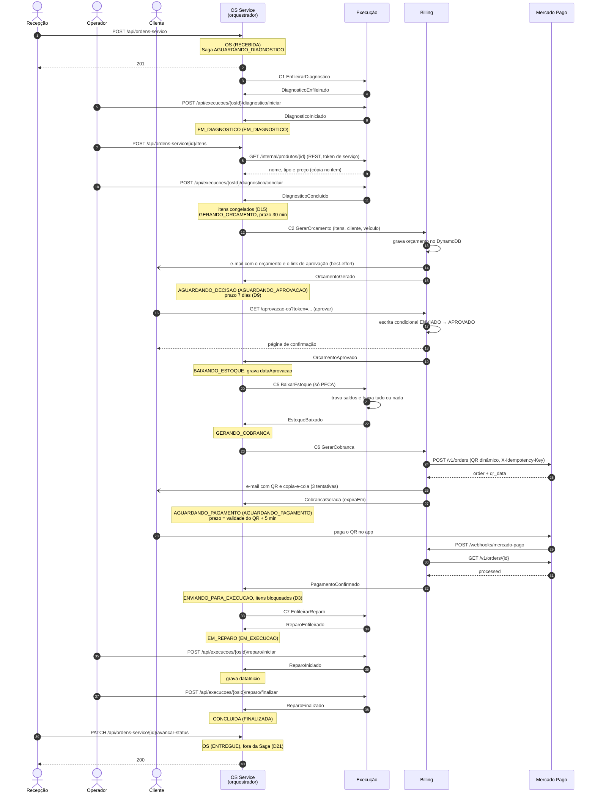
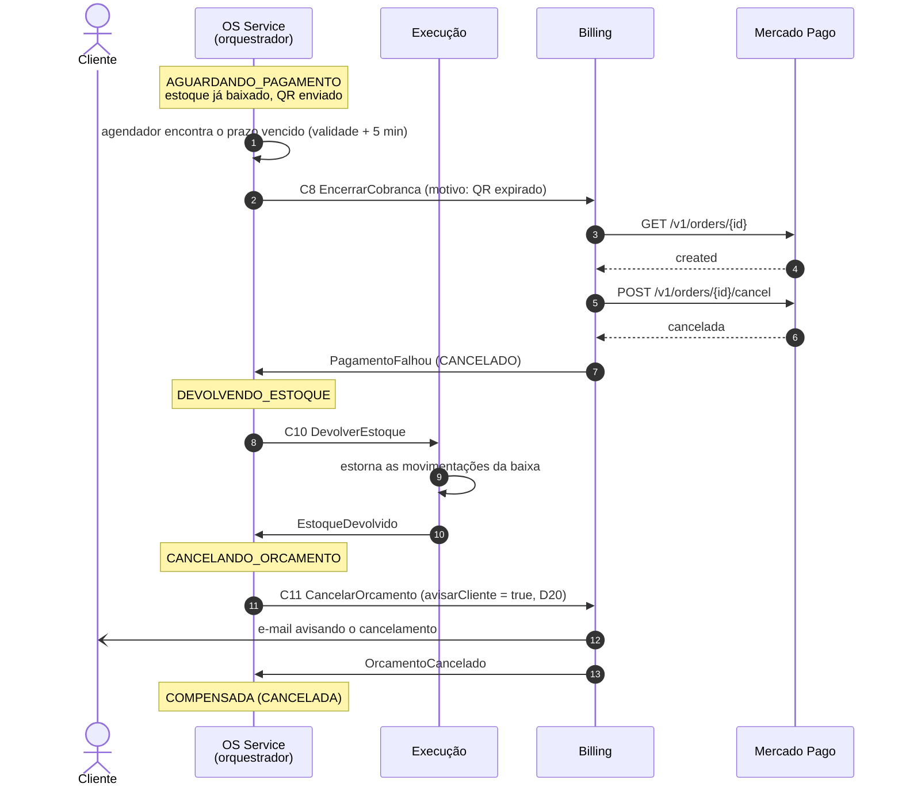
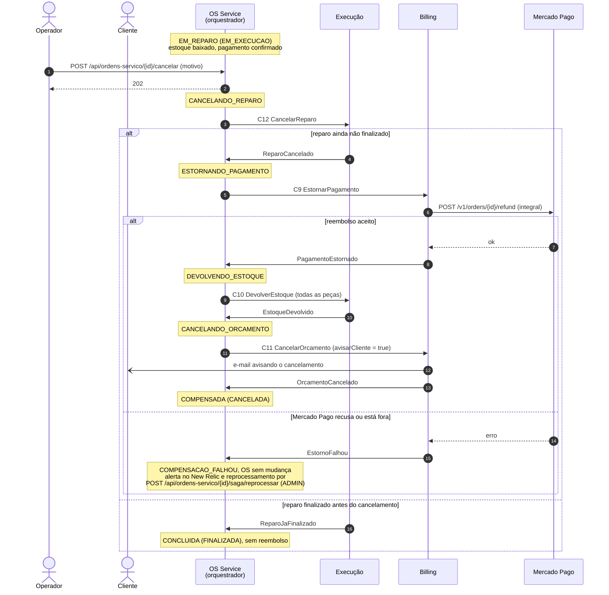
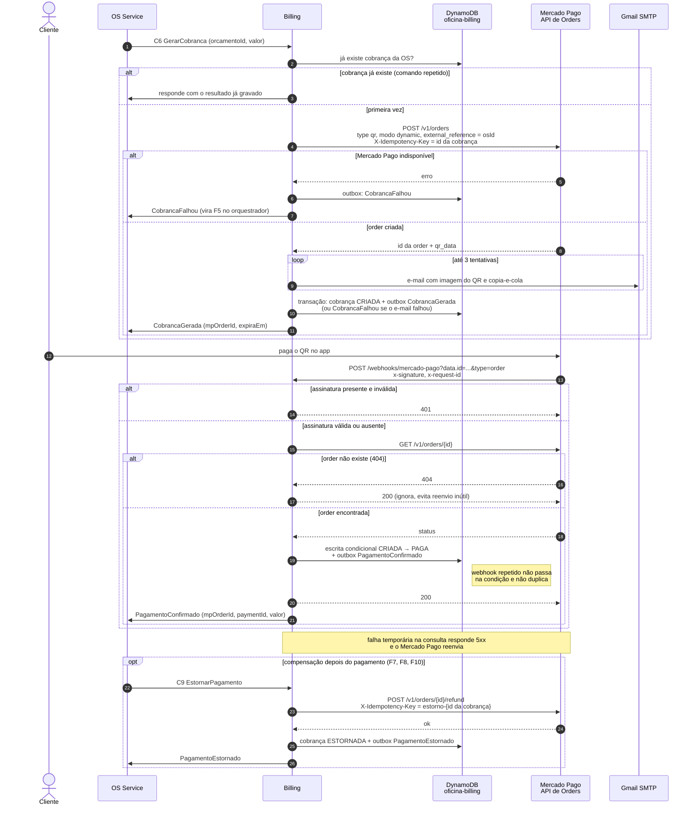

# Diagramas de sequência — Fase 4

Três fluxos, desenhados a partir do código (`OrquestradorSagaUseCase` no OS, `BillingUseCase` no Billing e
`ExecucaoController` na Execução). Estados da Saga em `MAIÚSCULAS`; entre parênteses, o status da OS.

Convenções:

- **Seta cheia entre serviços** (`->>`): comando ou evento por SQS. Quem publica grava a mensagem na outbox,
  na mesma transação da mudança de estado; quem consome confere a inbox por `messageId` antes de agir.
- **Seta tracejada** (`-->>`): resposta HTTP.
- Comandos vão do OS para `oficina-execucao-comandos` ou `oficina-billing-comandos`. Eventos voltam para
  `oficina-os-saga-eventos`. Catálogo completo (C1 a C12 e eventos) em
  [plano-secoes-0-4.md](plano-secoes-0-4.md#4-catálogo-de-eventos).
- O API Gateway e o JWT ficam fora dos diagramas: toda chamada de pessoa entra pelo Gateway, que valida o token
  antes de rotear ao NLB do serviço ([arquitetura.md](arquitetura.md)).

## 1. Saga: fluxo feliz

Da abertura da OS à entrega, com orçamento aprovado pelo link do e-mail e pagamento pelo QR.

A oficina também pode decidir pelo cliente com `PATCH /api/ordens-servico/{id}/aprovar` (202): o OS envia
C3 `RegistrarDecisaoOrcamento` e o Billing aplica a mesma escrita condicional do link (D11). OS sem itens ou com
total zero vai direto de `DiagnosticoConcluido` para `CONCLUIDA` (D16).

## 2. Saga: fluxos com compensação

Compensações rodam na ordem inversa dos passos e são idempotentes. Os dois casos abaixo cobrem a cadeia mais
curta e a mais longa; a tabela completa (F1 a F10) está no [README](../README.md#saga-orquestrada).

### 2.1 QR expirado sem pagamento (F6)

O cliente não paga dentro da validade do QR. O orquestrador detecta pelo prazo persistido na tabela `saga`, sem
depender do webhook.

Se a consulta mostrar a order `processed` (o cliente pagou no último instante), o Billing responde
`PagamentoConfirmado` e a OS segue o fluxo feliz. Pagamento que chega depois da Saga compensada é reembolsado
(F8, D19).

### 2.2 Cancelamento com reparo em andamento (F10)

A oficina cancela uma OS já paga e em reparo. É a cadeia completa: cancelar o reparo, reembolsar, devolver as
peças e cancelar o orçamento (D22).

## 3. Pagamento com o Mercado Pago

Visão do Billing: criação da order, envio do QR, webhook e reembolso. O webhook nunca confirma pagamento pelo
corpo: ele só diz qual order consultar.

A assinatura do webhook é conferida com o segredo do painel (`AssinaturaWebhook`). Em 15/11/2026, com um webhook
real, confirmou-se que o Mercado Pago assina o `data.id` na grafia original da order; o Billing aceita as duas
grafias. A API é a mesma para teste e produção (`api.mercadopago.com`): o ambiente vem da credencial.
